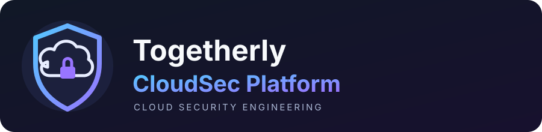

<!-- PROJECT LOGO -->
<p align="center">
  
</p>

<h1 align="center">Togetherly CloudSec Platform</h1>
<p align="center"><strong>A hands-on cloud security engineering project built around the Togetherly Workforce application.</strong></p>

<p align="center">
  <a href="https://github.com/Faizankhan-cyber/togetherly-cloudsec-platform"></a>
  <a href="https://github.com/Faizankhan-cyber/togetherly-cloudsec-platform/issues"></a>
  <a href="LICENSE"></a>
  
</p>

<p align="center">
  <a href="#-project-overview">Overview</a> ·
  <a href="#-the-five-version-roadmap">Roadmap</a> ·
  <a href="#-certification-roadmap">Certifications</a> ·
  <a href="#-technology-stack">Tech stack</a> ·
  <a href="docs/PROJECT_ROADMAP.md">Full roadmap</a>
</p>

---

## 🎯 Project overview

Togetherly CloudSec Platform is a long-term portfolio project focused on assessing and securing the existing **Togetherly Workforce** application, then gradually extending it with cloud identity, infrastructure automation, threat detection, and enterprise security controls.

The goal is to demonstrate practical engineering through working tools, secure configurations, infrastructure code, tests, architecture diagrams, and clear technical reports.

> **Assess → Secure → Integrate → Automate → Detect → Improve**

### Why this project?

- Uses a real application as the security case study.
- Connects application security with cloud security and operations.
- Builds practical evidence through code, tests, reports, and documented decisions.
- Follows a staged path instead of moving everything to the cloud at once.
- Connects each project stage to the skills being developed through certifications.

## 🧭 The five-version roadmap

| Version | Focus | Planned engineering outcome |
|:--:|---|---|
| **V1** | **Security Foundation** | Python assessment tool, application review, STRIDE threat model, OWASP checks, findings, fixes, and baseline report |
| **V2** | **Identity & Cloud Security** | Microsoft Entra ID, OAuth/OIDC, SSO, Azure RBAC, Managed Identity, and Key Vault |
| **V3** | **Infrastructure & DevSecOps** | Terraform, Bicep, Azure networking, GitHub Actions, and secure CI/CD |
| **V4** | **Security Operations** | Azure Monitor, Log Analytics, Microsoft Sentinel, KQL, Defender for Cloud, and incident investigation |
| **V5** | **Enterprise Architecture** | Azure Policy, governance, backup and recovery, disaster recovery, and Zero Trust architecture |

<details>
<summary><strong>What each version will cover</strong></summary>

### V1 · Security Foundation
Build a local Python security assessment engine, map the application architecture, perform STRIDE threat modelling, review relevant OWASP risks, validate findings, and document remediation.

### V2 · Identity & Cloud Security
Design and test Microsoft Entra ID integration, OAuth/OIDC, application role mapping, Azure RBAC, Managed Identities, and Key Vault. Application-level authorisation and database Row Level Security must remain in place.

### V3 · Infrastructure & DevSecOps
Create repeatable infrastructure using Terraform and Bicep, build Azure networking controls, and add GitHub Actions validation and controlled deployment workflows.

### V4 · Security Operations
Build log collection and KQL investigations, then add Sentinel detections, alerting, and incident response exercises. Review service costs before enabling paid ingestion or security plans.

### V5 · Enterprise Architecture
Complete governance, Azure Policy, backup and restore testing, disaster recovery planning, Zero Trust assessment, and final architecture documentation.

</details>

## 🎓 Certification roadmap

Certifications support the learning behind each version. They do **not** count as project completion by themselves.

| Target period | Certification / learning | Project connection |
|---|---|---|
| Preparation | DataCamp Python Fundamentals + Intermediate Python | V1 assessment engine |
| Preparation | Bash and PowerShell skills | V1 automation and V2/V3 administration |
| By February 2027 target | **AZ-900** · Azure Fundamentals | Azure foundations for V2–V5 |
| By February 2027 target | **GH-900** · GitHub Foundations | Repository workflows and collaboration |
| By February 2027 target | **AZ-104** · Azure Administrator Associate | V2 identity, V3 networking, V4 operations |
| By February 2027 target | **SC-500** · Cloud and AI Security Engineer Associate | V2 cloud security and V4 operations |
| BCA fourth semester | JavaScript | Application and web security knowledge |
| BCA fourth semester | **AWS CLF-C02** · Cloud Practitioner | Multi-cloud foundations |
| BCA fourth semester | **AWS SAA-C03** · Solutions Architect Associate | Architecture decisions in V3/V5 |
| BCA fourth semester | **Terraform Associate (004)** | V3 Infrastructure as Code |
| Final year | **AZ-305** · Azure Solutions Architect Expert | V5 enterprise architecture |
| Final year | **AWS Certified Security – Specialty** | Advanced cloud security for V4/V5 |

<details>
<summary><strong>Certification-to-version alignment</strong></summary>

| Project version | Supporting certifications and skills |
|---|---|
| V1 · Security Foundation | DataCamp Python, Bash, PowerShell |
| V2 · Identity & Cloud Security | AZ-900, AZ-104, SC-500, GH-900 |
| V3 · Infrastructure & DevSecOps | Terraform Associate (004), AZ-104, AWS CLF-C02, AWS SAA-C03 |
| V4 · Security Operations | SC-500, AZ-104, AWS Security Specialty |
| V5 · Enterprise Architecture | AZ-305, AWS Security Specialty, AWS SAA-C03 |

</details>

**Planning note:** These are target milestones, not claims that the exams have already been passed. Dates may change with exam availability and college schedules.

## 🧰 Technology stack

<p>
  
  
  
  
  
  
  
  
</p>

The existing Togetherly Workforce application currently uses:

| Layer | Technology |
|---|---|
| Frontend | React, TypeScript, Vite |
| Authentication | Supabase Auth |
| Database and access control | Supabase PostgreSQL and Row Level Security |
| Storage and backend operations | Supabase Storage and Edge Functions |
| Hosting and CI/CD | Vercel, GitHub, GitHub Actions |

Azure services will be introduced in controlled stages. The existing application will not be migrated without a clear technical reason and a reviewed implementation plan.

## 📍 Current progress

<kbd>V1 · Security Foundation</kbd> <strong>In progress</strong>

Initial security groundwork has been completed on the Togetherly application, including reviews of GitHub security settings, Supabase authentication and RLS, storage, Edge Functions, and deployment configuration. Selected improvements have been applied and documented.

**Still to build in V1:**
- Python security assessment engine
- Full application threat model
- Structured security assessment and findings
- Remediation validation and tests
- Final security baseline report

**V2–V5 are planned stages. They are not complete.**

## 🗂️ Repository structure

```text
togetherly-cloudsec-platform/
├── assets/
│   └── cloudsec-logo.svg
├── docs/
│   └── PROJECT_ROADMAP.md
├── V1-security-foundation/
├── V2-identity-cloud-security/
├── V3-infrastructure-devsecops/
├── V4-security-operations/
├── V5-enterprise-architecture/
├── .gitignore
├── LICENSE
├── README.md
└── SECURITY.md
```

Implementation folders will be populated as each stage begins.

## 🔐 Engineering principles

- Inspect before changing anything.
- Work in small, testable steps and use Git branches and pull requests.
- Prefer local or staging environments for experiments.
- Protect production data and services.
- Record findings, fixes, test results, and design decisions.
- Never commit passwords, API keys, tokens, private keys, or sensitive data.
- Estimate Azure costs before deployment and remove temporary resources after testing.

## 🔗 Project links

- **Case-study application:** [Togetherly Workforce](https://togetherly-tinyfish.vercel.app/)
- **Application source:** [togetherly-workforce](https://github.com/Faizankhan-cyber/togetherly-workforce)
- **Detailed project and certification roadmap:** [PROJECT_ROADMAP.md](docs/PROJECT_ROADMAP.md)

---

<p align="center">
  <strong>Built as a practical cloud security engineering portfolio project.</strong><br>
  <sub>Learning, building, testing, documenting, and improving one version at a time.</sub>
</p>

> This is an independent educational and portfolio project. Security testing must be authorised and limited to systems and environments for which permission has been granted.
