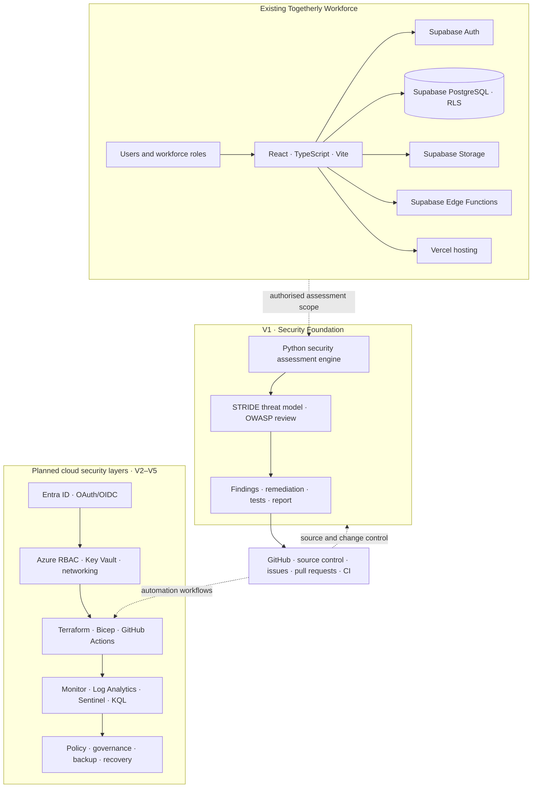

# System Context and Security Architecture

## Purpose

This document describes the current Togetherly Workforce application and the planned security engineering layers. It deliberately separates deployed components from future design. The diagram is a system-context view, not a claim that all integrations are already implemented.

## Current application

- **Frontend and hosting:** React, TypeScript, Vite, hosted on Vercel.
- **Authentication:** Supabase Auth.
- **Database and row-level access:** Supabase PostgreSQL with Row Level Security (RLS).
- **File handling:** Supabase Storage.
- **Backend operations:** Supabase Edge Functions.
- **Source control and delivery:** GitHub and GitHub Actions.

## Planned project layers

- **V1:** A local Python assessment tool, application inventory, trust-boundary review, STRIDE threat model, OWASP review, findings, remediation validation, and a baseline report.
- **V2:** Microsoft Entra ID integration, OAuth/OIDC, role mapping, Azure RBAC, Managed Identity, and Key Vault.
- **V3:** Terraform/Bicep infrastructure, Azure network controls, and secure CI/CD.
- **V4:** Azure Monitor, Log Analytics, Microsoft Sentinel, KQL detections, and incident exercises.
- **V5:** Azure Policy, governance, backup/restore, disaster recovery, and enterprise architecture.

## System context diagram

## Trust boundaries and design rules

1. **Browser boundary:** Treat browser input and client-side state as untrusted. Enforce access rules on trusted server/database boundaries.
2. **Authentication vs authorisation:** A successful sign-in does not grant every application permission. Keep role checks and resource-level authorisation.
3. **Database boundary:** Supabase RLS remains an independent enforcement layer. Do not replace it with frontend checks or identity-provider claims alone.
4. **Privileged operations:** Keep service-role credentials and other secrets on trusted server-side systems. Never ship them to the browser or commit them.
5. **Evidence boundary:** Assessment output must be sanitised. Do not copy real employee data, access tokens, private logs, or secrets into the repository.
6. **Cloud cost boundary:** Deploy cloud resources only after reviewing cost, scope, access, cleanup, and rollback requirements.

## Review status

This diagram is a maintained design artefact. Update it when a component is implemented, removed, or materially changed. Record the date and evidence for any claim that a planned integration has become live.
